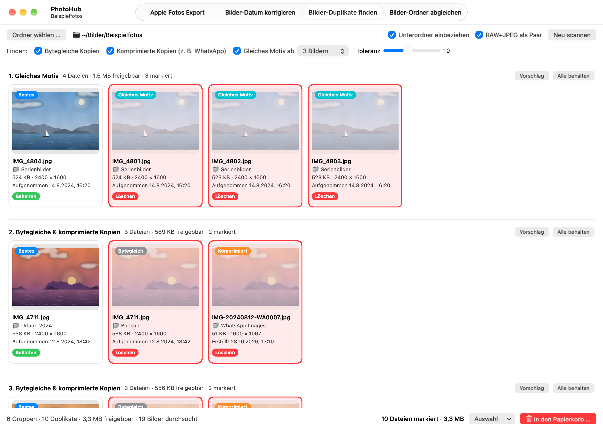

# PhotoHub

Native macOS-App, die in einem Ordner doppelte Fotos findet und sie nach deiner Prüfung in den Papierkorb verschiebt (**Bilder-Duplikate finden**). Außerdem kopiert sie Exporte aus Apple Fotos in eine Jahr/Monat-Struktur (**Apple Fotos Export**), korrigiert das Dateidatum von Fotos und Videos anhand der Aufnahmezeit (**Bilder-Datum korrigieren**) und ergänzt einen Ordner um die Fotos und Videos, die ihm gegenüber einem anderen Ordner fehlen (**Bilder-Ordner abgleichen**). Läuft vollständig lokal – ohne Internet, ohne Xcode, ohne Apple-Entwicklerzertifikat.



<sub>Der Screenshot zeigt ausschließlich künstlich erzeugte Beispielbilder.</sub>

## Installation

**Voraussetzungen:** macOS 13 oder neuer und die Command Line Tools (`xcode-select --install`).

```bash
git clone https://github.com/marionitschke/photohub.git
cd photohub
./build.sh --install
```

Die App liegt danach unter `/Applications/PhotoHub.app`. Weil sie auf deinem Mac gebaut und ad hoc signiert wird, startet sie ohne Gatekeeper-Abfrage. Beim ersten Zugriff auf geschützte Ordner (Schreibtisch, Dokumente, iCloud Drive, externe Laufwerke) fragt macOS einmal nach Erlaubnis.

- **Aktualisieren:** `git pull && ./build.sh --install`
- **Deinstallieren:** `rm -rf /Applications/PhotoHub.app ~/Library/Caches/local.photohub && defaults delete local.photohub`

## Bedienung

Oben in der Titelleiste wechselst du zwischen **Apple Fotos Export**, **Bilder-Datum korrigieren**, **Bilder-Duplikate finden** und **Bilder-Ordner abgleichen** (⌘1 bis ⌘4).

### Apple Fotos Export

1. **Export aus Fotos** wählen – den Ordner mit Tagesordnern wie „1. August 2026“ – und das **Ziel**, z. B. dein Foto-Backup.
2. Die Vorschau zeigt je Tagesordner, wohin er kommt (`2026/08`), wie viele Dateien kopiert und umbenannt werden und was schon im Ziel liegt.
3. **Kopieren …** kopiert die Dateien, der Export bleibt unverändert. **Rückgängig** legt die Kopien in den Papierkorb, **Ziel auf Duplikate prüfen** wechselt danach in die Duplikatsuche.

Weil der Export erhalten bleibt, kannst du jederzeit neu anfangen oder nach einem Abbruch weitermachen: Was schon im Ziel liegt, wird erkannt und übersprungen.

### Bilder-Datum korrigieren

1. **Ordner** wählen oder ins Fenster ziehen, dann **Prüfen**.
2. Die Liste zeigt jede Datei, deren „Erstellt“, „Geändert“ oder „Hinzugefügt“ nicht zur Aufnahmezeit passt – Abweichungen in Orange.
3. **Datum korrigieren …** setzt alle drei auf die Aufnahmezeit, **Rückgängig** stellt die alten Daten wieder her.

### Bilder-Duplikate finden

1. **Ordner wählen …** oder einen Ordner ins Fenster ziehen.
2. Unter **Finden** auswählen, wonach gesucht wird, und **Scannen** klicken.
3. Vorschläge prüfen: **Klick** auf eine Kachel schaltet zwischen *Behalten* und *Löschen* um, **Doppelklick** öffnet das Foto, **Rechtsklick** bietet z. B. „Alle Duplikate in diesem Ordner markieren“.
4. **In den Papierkorb …** verschiebt die markierten Dateien, **Rückgängig** holt sie zurück.

Optionen und Toleranz lassen sich nach dem Scan ändern; die Gruppen werden sofort neu berechnet.

### Bilder-Ordner abgleichen

1. **Quelle (A)** wählen oder ins Fenster ziehen, dann den Ordner **B**, der ergänzt werden soll.
2. Die Liste zeigt jedes Foto und Video aus A, das in B fehlt, und wohin es kommt: in denselben Unterordner wie in A.
3. **Nach B verschieben …** verschiebt diese Dateien, **Rückgängig** holt sie zurück nach A.

Danach liegt in A nur noch, was es auch in B gibt.

## Funktionsweise

| Option | Findet | Markiert |
|---|---|---|
| **Bytegleiche Kopien** | exakt gleiche Dateien | die Kopien |
| **Komprimierte Kopien** | dasselbe Foto in schlechterer Qualität, z. B. per WhatsApp geteilt | die schlechtere Version |
| **Gleiches Motiv ab N Bildern** | verschiedene Aufnahmen mit gleichem Bildaufbau, z. B. Serienbilder | alle außer der besten |

- **Bytegleich:** gleich große Dateien werden per SHA-256 verglichen.
- **Bild-Fingerabdruck:** Jedes Bild wird auf 9 × 9 Felder mittlerer Helligkeit verkleinert. Er ändert sich kaum durch Verkleinern oder Komprimieren, aber deutlich, wenn sich der Bildaufbau ändert – Kopf links und Kopf rechts sind zwei Motive.
- **Kopie oder eigene Aufnahme:** Bei fast gleichem Fingerabdruck entscheidet die Qualität. Geringere Auflösung oder deutlich kleinere Datei → komprimierte Kopie; gleiche Qualität → eigene Aufnahme mit gleichem Motiv. Bei gleicher Auflösung zählt vor der Dateigröße die Schärfe – ein verwackeltes, verrauschtes Serienbild ist oft die größte Datei, gilt aber nicht als Original.
- **Toleranz** (nur „Gleiches Motiv“, Standard 10): niedrig = fast identischer Bildaufbau, hoch = auch leicht verschobene Aufnahmen, aber mehr Fehltreffer.
- **Beste Datei:** höchste Auflösung, größte Datei, kein „Kopie“ im Namen, ältestes Original. Bei „Gleiches Motiv“ zählt die Aufnahme selbst: Mit Personen gewinnt das Foto, auf dem niemand die Augen geschlossen hat, das nicht unscharf ist und die beste Gesichtsqualität hat (Apple Vision, lokal); ohne Personen die schärfste Aufnahme, sofern sie deutlich schärfer ist. Gemessen wird die Schärfe in den schärfsten Bildbereichen, also meist am Motiv im Fokus. Plaketten **„Augen zu“** und **„Unscharf“** zeigen, warum eine Aufnahme nicht die beste ist.
- **Begleitdateien:** Live-Photo-Videos (`.MOV`), `.AAE`-Bearbeitungen und `.XMP`-Dateien gleichen Namens wandern mit dem Foto in den Papierkorb und mit „Rückgängig“ zurück. Ist die Zuordnung nicht eindeutig, bleiben sie unangetastet.
- **RAW+JPEG als Paar** (Standard: an): RAW und JPEG gleichen Namens im selben Ordner gelten als ein Foto – das JPEG wird nicht als komprimierte Kopie markiert und wandert mit dem RAW.
- **Scan-Cache:** Prüfsummen, Fingerabdrücke, Schärfe und Gesichtsprüfungen werden pro Datei gespeichert (`~/Library/Caches/local.photohub`). Ein erneuter Scan liest nur neue oder geänderte Fotos (andere Größe oder anderes Änderungsdatum); auch ein abgebrochener Scan wird so beim nächsten Mal fortgesetzt. **Ablage → Scan-Cache leeren** erzwingt eine komplette Neuanalyse.
- **Apple Fotos Export:** Dateien aus Tagesordnern mit deutschem Datum („1. August 2026“, auch „3. Maerz 2025“) werden nach `Ziel/JJJJ/MM` kopiert, andere Ordner und Unterordner bleiben unberücksichtigt. Liegt im Ziel schon eine Datei mit gleichem Namen und gleichem Inhalt (Größe, Anfang und Ende der Datei), wird sie übersprungen; bei anderem Inhalt landet die Kopie als `Name_1` – Live Photos (HEIC + MOV) gemeinsam. Auf APFS entstehen die Kopien als Klone: sofort fertig und ohne zusätzlichen Speicherplatz, bis sich eine Seite ändert. Auf ein anderes Laufwerk wird vorher geprüft, ob der Platz reicht. Auf Wunsch zeigen die Kopien im Finder bei „Erstellt“, „Geändert“ und „Hinzugefügt“ die Aufnahmezeit aus EXIF bzw. Video-Metadaten, mit Zeitzone.
- **Bilder-Datum korrigieren:** dieselbe Aufnahmezeit-Logik wie beim Apple Fotos Export, angewendet auf Fotos und Videos am Ort. Verändert werden nur die drei Finder-Daten, nie die Bilddaten. Dateien ohne Aufnahmezeit bleiben, wie sie sind; Dateien, die nur in iCloud liegen, werden nicht heruntergeladen und übersprungen.
- **Bilder-Ordner abgleichen:** Eine Datei aus A fehlt in B, wenn dort nirgends eine Datei mit gleichem Inhalt liegt (SHA-256 der ganzen Datei, Name und Unterordner egal). Verglichen werden Fotos, Videos und `.AAE`/`.XMP`-Dateien; andere Dateien bleiben in A. Ist der Name in B schon für eine andere Datei vergeben, kommt sie als `Name_1` dazu – Live Photos gemeinsam. Liegt dieselbe Datei mehrfach in A, wandert nur eine. „Erstellt“, „Geändert“ und „Hinzugefügt“ bleiben erhalten. Auf ein anderes Laufwerk wird erst kopiert und geprüft, dann das Original in A entfernt. Dateien, die nur in iCloud liegen, werden nicht heruntergeladen und nicht verglichen.
- **Sicherheit:** PhotoHub löscht nie endgültig. Apple-Fotos-Mediatheken und versteckte Dateien werden übersprungen. Treffer bei „Gleiches Motiv“ vor dem Löschen prüfen.
